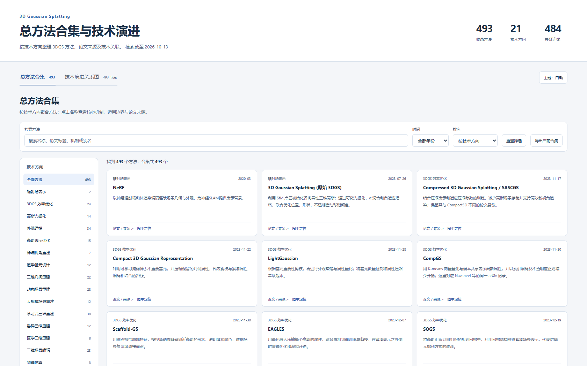
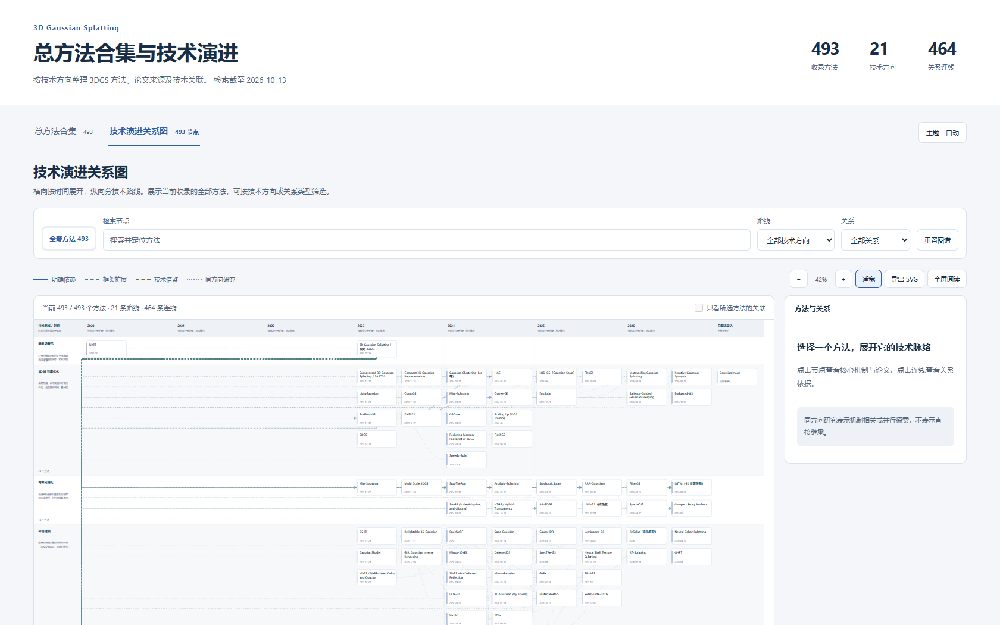
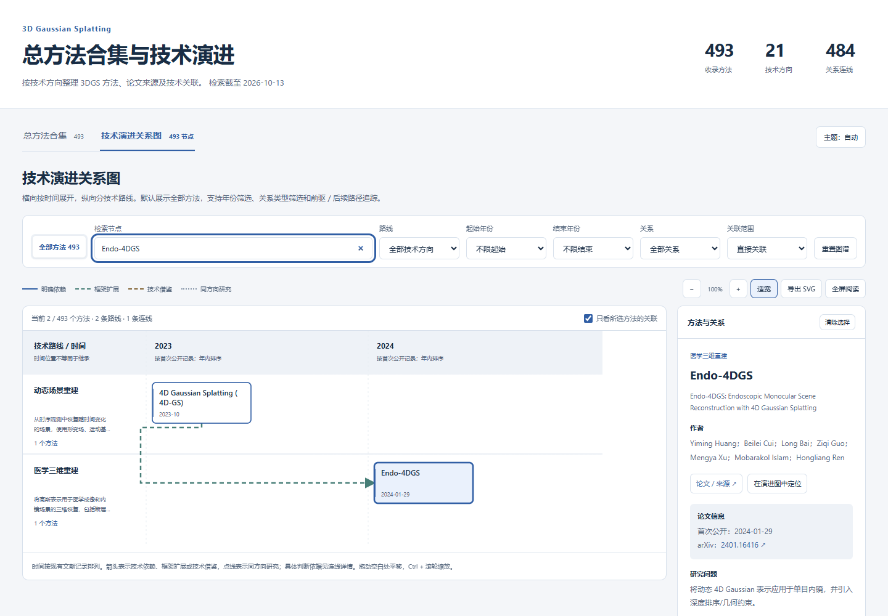
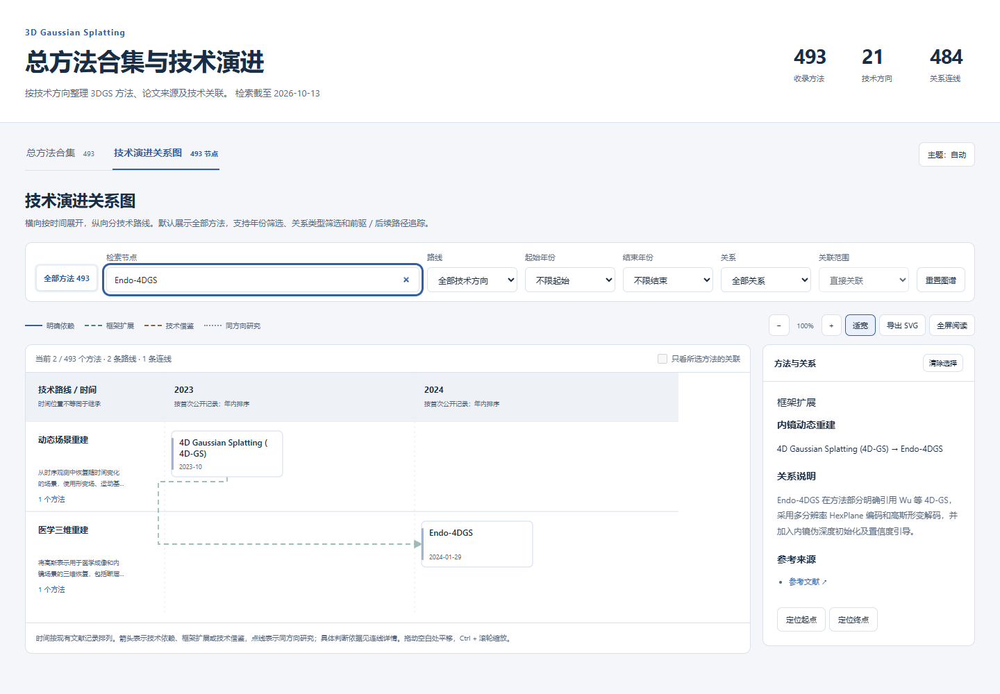
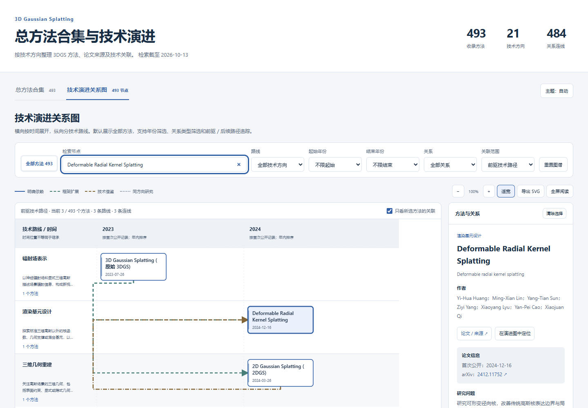
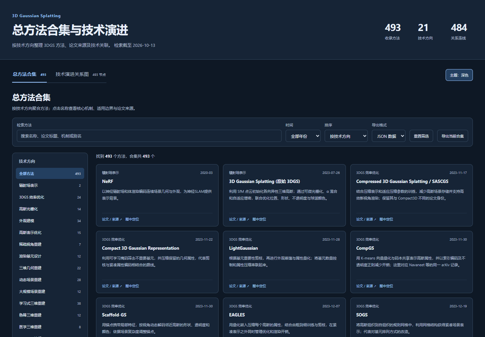

<p align="center">
  
</p>

<h1 align="center">Research Atlas</h1>

<p align="center">
  <strong>从综述论文到技术演进图</strong><br>
  根据综述和原始论文，整理方法合集、技术分类和有来源依据的技术关系。
</p>

<p align="center">
  <a href="SKILL.md"></a>
  <a href="#本地构建与校验"></a>
  <a href="examples/3dgs/README.md"></a>
  <a href="references/paper-extraction-schema.md"></a>
</p>

<p align="center">
  <a href="examples/3dgs/README.md"></a>
  <a href="#安装"></a>
  <a href="SKILL.md"></a>
</p>

<table>
  <tr>
    <td width="50%">
      <strong>总方法合集</strong><br>
      按技术分类检索方法，查看论文、机制和来源。
      <a href="docs/images/3dgs-method-catalog.png"></a>
    </td>
    <td width="50%">
      <strong>技术演进关系图</strong><br>
      浏览全部方法，沿时间轴查看技术联系。
      <a href="docs/images/3dgs-evolution-map.png"></a>
    </td>
  </tr>
</table>

<p align="center"><sub>上图为真实 3DGS 示例，点击可查看大图。交互体验请下载仓库后打开 <code>examples/3dgs/index.html</code>。</sub></p>

<a name="主要功能"></a>

##  主要功能

<p align="center">
  <picture><source media="(prefers-color-scheme: dark)" srcset="docs/brand/feature-extract-dark.svg"></picture>
  <picture><source media="(prefers-color-scheme: dark)" srcset="docs/brand/feature-catalog-dark.svg"></picture>
  <picture><source media="(prefers-color-scheme: dark)" srcset="docs/brand/feature-taxonomy-dark.svg"></picture>
  <picture><source media="(prefers-color-scheme: dark)" srcset="docs/brand/feature-relations-dark.svg"></picture>
  <picture><source media="(prefers-color-scheme: dark)" srcset="docs/brand/feature-search-dark.svg"></picture>
  <picture><source media="(prefers-color-scheme: dark)" srcset="docs/brand/feature-export-dark.svg"></picture>
</p>

<a name="安装"></a>

##  安装

将完整仓库放入用户级 Skill 目录，确保 `SKILL.md` 位于该目录根部：

```bash
git clone https://github.com/3465252812/research-atlas.git ~/.agents/skills/research-evolution-map
```

Windows 用户目录通常为 `%USERPROFILE%/.agents/skills/research-evolution-map`。也可将仓库放入项目的 `.agents/skills/research-evolution-map`。如果已有同名 Skill，请先备份或在原目录更新，避免重复安装。Private 仓库需要对应的 GitHub 访问权限。

在 Codex 中查找 **Research Atlas｜科研技术图谱**，或输入 `$research-evolution-map` 调用。GitHub 仓库名为 `research-atlas`；Skill 安装目录和调用名沿用 `research-evolution-map`，兼容现有项目。未显示时可重启 Codex。

数据脚本要求 **Python 3.10+**，只依赖标准库。文献阅读和联网检索由 Codex 结合当前可用工具完成。

<a name="使用示例"></a>

##  使用示例

```text
使用 $research-evolution-map，研究领域为【领域名称】。
请阅读【综述文件或链接】，研究时间范围为【起止时间】，
整理方法合集、技术分类和演进关系，并补充相关新文献，
最终生成交互式 HTML、JSON 数据、文献清单和核验报告。
```

你会得到可独立打开的 **HTML**、可继续更新的 **JSON 数据**、**CSV/BibTeX 文献清单**，以及检索核验报告和未核实问题清单。更新项目时，提供原始 JSON 和新增资料即可；已有数据也可用于进一步整理专题方向。

<a name="工作流程"></a>

##  工作流程

<picture>
  <source media="(max-width: 600px) and (prefers-color-scheme: dark)" srcset="docs/brand/workflow-mobile-dark.svg">
  <source media="(max-width: 600px)" srcset="docs/brand/workflow-mobile-light.svg">
  <source media="(prefers-color-scheme: dark)" srcset="docs/brand/workflow-dark.svg">
  
</picture>

综述解析、方法提取、去重、分类、关系分析、沿路线补充文献和 HTML 构建连续完成。分类依据、来源位置、事实或推断及核验状态随数据保存，交付时汇总需要进一步讨论的问题。

<a name="html-输出效果"></a>

##  HTML 输出效果

以 **3D Gaussian Splatting** 为例，使用同一份结构化数据生成方法合集和技术演进关系图：

<picture>
  <source media="(max-width: 600px) and (prefers-color-scheme: dark)" srcset="docs/brand/3dgs-stats-mobile-dark.svg">
  <source media="(max-width: 600px)" srcset="docs/brand/3dgs-stats-mobile-light.svg">
  <source media="(prefers-color-scheme: dark)" srcset="docs/brand/3dgs-stats-dark.svg">
  
</picture>

<br>

| 页面 | 主要内容 |
|---|---|
| 总方法合集 | 分类导航、名称／作者／机制搜索、年份筛选、排序分页、论文与方法详情、JSON／CSV／BibTeX 导出 |
| 技术演进关系图 | 默认展示全部方法、时间轴、起止年份、四类关系筛选、前驱／后续路径、节点与连线详情、定位高亮、缩放拖动、全屏及 SVG 导出 |

图谱首次打开和重置后均显示全部方法。搜索或筛选后可以查看局部关联；技术路径沿已有技术边展开，同方向研究不作为继承路径。

[操作指南](examples/3dgs/README.md) · [HTML 文件](examples/3dgs/index.html) · [JSON 数据](examples/3dgs/project-data.json) · [文献 CSV](examples/3dgs/bibliography.csv) · [BibTeX](examples/3dgs/bibliography.bib)

GitHub 文件页面显示 HTML 源码；下载后用浏览器打开即可交互，无需服务器或前端依赖。

<details>
<summary><strong>查看完整操作演示</strong>：分类、详情、关系依据、技术路径和导出</summary>


可以从这些操作开始体验：

1. 在合集选择“稀疏视角重建”和“2024”，查看4个方法并导出文献。
2. 在图谱搜索 `Endo-4DGS`，点击与 `4D-GS` 的连线，阅读关系说明和原论文依据。
3. 搜索 `Deformable Radial Kernel Splatting`，选择“前驱技术路径”，浏览已有技术边中的多级前驱。
4. 组合年份和关系类型筛选；重置回全部方法后，导出完整 SVG。

</details>

<details>
<summary>方法详情、搜索关联和原文依据截图</summary>






</details>

<details>
<summary>多级路径、年份筛选、深色主题和移动端截图</summary>







</details>

示例保留实际核验状态，不代表全部信息已核实或文献收录穷尽。另有 `assets/example-data.json` 作为小型虚构数据，用于脚本和交互测试。

<a name="本地构建与校验"></a>

##  本地构建与校验

<details>
<summary>展开脚本命令、构建输出和校验说明</summary>

在仓库根目录运行：

```bash
python scripts/self_test.py
python scripts/validate_data.py assets/example-data.json --report output/validation.json
python scripts/build_html.py assets/example-data.json --output output/evolution-map.html
```

打开 `output/evolution-map.html` 即可查看示例。示例中的待核警告是刻意保留的测试内容；结构校验通过不代表学术事实已核实。实际项目应按[数据契约](references/paper-extraction-schema.md)提供数据。

重新构建 3DGS 实际示例：

```bash
python scripts/build_html.py examples/3dgs/project-data.json --output output/3dgs/index.html
```

```bash
python scripts/deduplicate_papers.py project.json --report output/duplicates.json
python scripts/build_html.py project.json --output output/evolution-map.html
python scripts/export_bibliography.py project.json --output-dir output
```

构建会输出 HTML、完整 JSON、分类和关系数据、CSV/BibTeX、校验报告及待核清单。`--strict` 会把待核等警告也视为失败，适用于完成核验后的验收。

</details>

<a name="目录结构"></a>

##  目录结构

<details>
<summary>查看 Skill 文件和开发资源</summary>

```text
research-atlas/
├── SKILL.md
├── README.md
├── agents/openai.yaml
├── assets/                 # 通用 HTML 模板、虚构示例和 Skill 图标
├── references/             # 工作流、分类、关系和证据规范
├── scripts/                # 校验、去重、构建、导出及自测
├── examples/3dgs/          # 通用模板生成的 3DGS HTML 与 JSON
└── docs/                   # 真实截图、README 图标和视觉素材
```

核心执行规则见 [SKILL.md](SKILL.md)。除专门整理的示例外，私人文献库、原始论文全文及构建和测试输出均不纳入仓库；请将个人研究资料保存在单独项目目录。

</details>

<p align="center">
  <a href="SKILL.md">Skill 使用规范</a> ·
  <a href="references/paper-extraction-schema.md">数据结构</a> ·
  <a href="references/relationship-classification.md">技术关系判断</a> ·
  <a href="docs/brand/THIRD_PARTY_NOTICES.md">图标许可</a>
</p>
