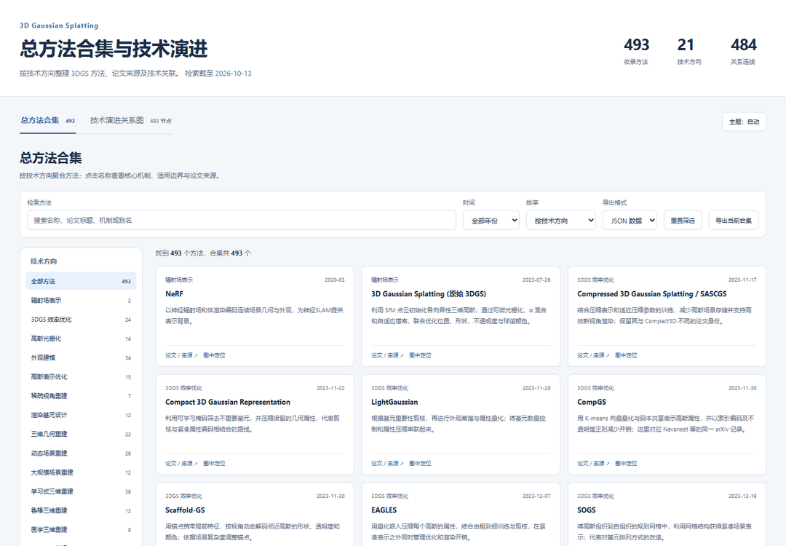
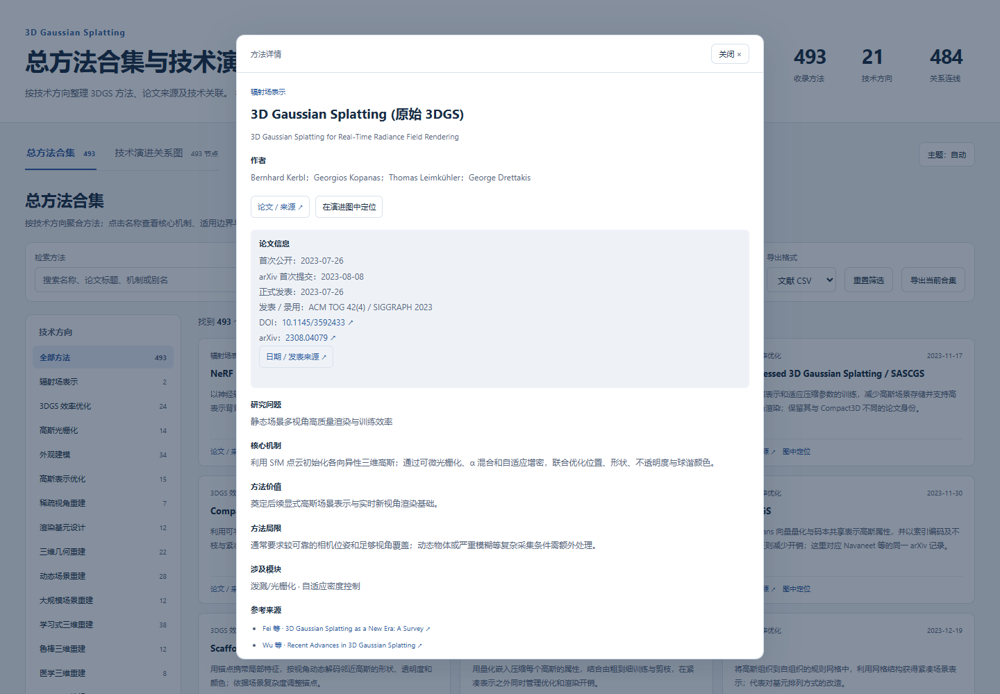
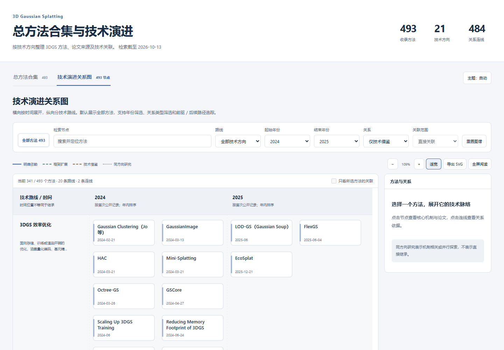
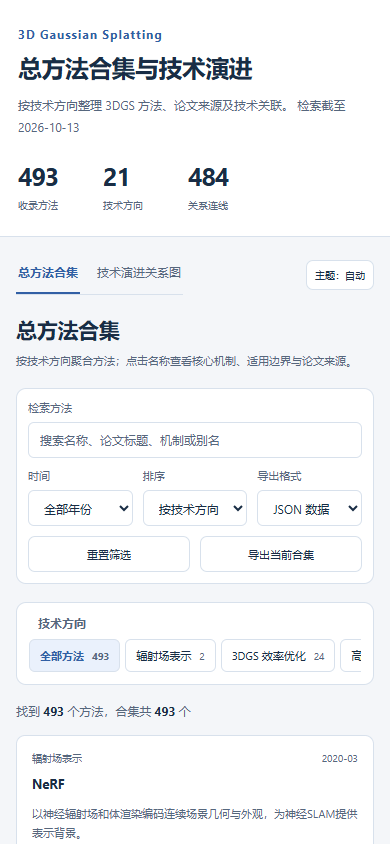

# Research Evolution Map

面向科研文献整理的 Codex Skill。从综述与原始论文中提取方法、整合文献、归纳技术分类、分析有证据的技术关系，并生成可独立打开的交互式 HTML 技术演进图。

[3DGS 完整演示与操作说明](examples/3dgs/README.md) · [交互式 HTML（下载后打开）](examples/3dgs/index.html) · [JSON 数据](examples/3dgs/project-data.json)



动图来自实际 HTML 操作。示例默认展示 **493 个方法、21 个技术方向、484 条关系**；局部视图由搜索或筛选产生，重置后恢复全部方法。GitHub 中的 HTML 链接显示源码，下载仓库后直接打开 `examples/3dgs/index.html` 即可交互浏览。

## 主要功能

- **文献与方法整理**：区分论文和方法，支持一文多法、去重、稳定 ID 与来源追溯。
- **技术分类与演进分析**：归纳一、二级分类和辅助标签；区分直接依赖、框架扩展、技术借鉴与同方向研究。
- **证据与不确定性管理**：记录原文位置、阅读层级、事实或推断、核验状态和置信度；未知信息保留待核。
- **交互式知识图谱**：方法搜索、分类与年份范围筛选、详情、关系高亮、前驱／后续多级路径、时间轴、缩放拖动、全屏及 SVG 导出。
- **数据管理**：JSON 数据与展示分离；页面可直接将当前筛选结果导出为 JSON、文献 CSV 或 BibTeX，并支持脚本校验、增量更新和基于现有数据的专题整理。

## 工作流程

综述解析 → 文献与方法提取 → 去重整合 → 技术分类 → 关系分析 → 沿路线补充文献 → HTML 生成与质量检查。

默认连续完成整理。普通争议保留分类依据、候选归属和待核标记，仅对无法依据现有文献判断、且显著影响整体研究范围或分类体系的问题询问用户。交付时汇总未核信息和可讨论的问题。

## 安装

将完整仓库放入用户级 Skill 目录，确保 `SKILL.md` 位于该目录根部：

```bash
git clone https://github.com/3465252812/research-evolution-map.git ~/.agents/skills/research-evolution-map
```

Windows 用户目录通常为 `%USERPROFILE%/.agents/skills/research-evolution-map`。也可将仓库放入项目的 `.agents/skills/research-evolution-map`。如果已有同名 Skill，请先备份或在原目录更新，避免重复安装。Private 仓库需要对应的 GitHub 访问权限。

在 Codex 中输入 `$research-evolution-map` 调用；未显示时可重启 Codex。数据脚本要求 **Python 3.10+**，只依赖标准库。文献阅读和联网检索由 Codex 结合当前可用工具完成。

## 使用示例

```text
使用 $research-evolution-map，研究领域为【领域名称】。
请阅读【综述文件或链接】，研究时间范围为【起止时间】，
整理方法合集、技术分类和演进关系，并补充相关新文献，
最终生成交互式 HTML、JSON 数据、文献清单和核验报告。
```

更新已有项目时，提供原始 JSON 和需要补充的资料即可；专题需求可直接利用已有合集和图谱继续整理。

## HTML 输出效果

HTML 包含两个页面，资源内嵌，可通过本地浏览器打开：

| 页面 | 主要内容 |
|---|---|
| 总方法合集 | 分类导航、名称／作者／机制搜索、年份筛选、排序分页、论文与方法详情、JSON／CSV／BibTeX 导出 |
| 技术演进关系图 | 默认展示全部方法、时间轴、起止年份、四类关系筛选、前驱／后续路径、节点与连线详情、定位高亮、缩放拖动、全屏及 SVG 导出 |

仓库提供一个基于既有文献记录整理的 **3DGS 实际示例**：493 个方法、21 类技术方向、484 条技术关联。使用当前通用模板展示方法合集与演进图，详情提供可读的论文信息和去重后的综述来源，完整核验记录保存在 JSON 和构建报告中。搜索单个方法时保留其直接关联，方便查看前驱与后续。

- [查看示例说明](examples/3dgs/README.md)
- [下载 HTML](examples/3dgs/index.html)：下载后本地打开，或克隆仓库后直接打开该文件。
- [查看 JSON 数据](examples/3dgs/project-data.json)
- [文献 CSV](examples/3dgs/bibliography.csv) · [BibTeX](examples/3dgs/bibliography.bib)：由同一份完整数据生成。

可以直接尝试以下操作：

1. 在合集选择“稀疏视角重建”和“2024”，查看4个方法，将导出格式切换为“文献 CSV”或“BibTeX”。
2. 在图谱搜索 `Endo-4DGS`，查看其与 `4D-GS` 的关联；点击绿色连线阅读关系说明和原论文依据。
3. 搜索 `Deformable Radial Kernel Splatting`，将“关联范围”改为“前驱技术路径”，浏览已有技术关系中的多级前驱。
4. 设置起止年份并切换关系类型；使用“重置图谱”回到全部方法，再导出完整 SVG。

路径追踪只沿现有技术边展开，同方向研究不作为继承路径；原记录中的推断性质和证据状态保持不变。

<details>
<summary>方法详情、搜索关联和原文依据截图</summary>




</details>

<details>
<summary>多级路径、年份筛选、深色主题和移动端截图</summary>







</details>

示例保留实际核验状态，不代表全部信息已核实或文献收录穷尽。另有 `assets/example-data.json` 作为小型虚构数据，用于脚本和交互测试。

## 本地构建与校验

在仓库根目录运行：

```bash
python scripts/self_test.py
python scripts/validate_data.py assets/example-data.json --report output/validation.json
python scripts/build_html.py assets/example-data.json --output output/evolution-map.html
```

打开 `output/evolution-map.html` 即可查看示例。示例中的待核警告是刻意保留的测试内容；结构校验通过不代表学术事实已核实。实际项目应按[数据契约](references/paper-extraction-schema.md)提供数据。

重新构建 3DGS 实际示例：

```bash
python scripts/build_html.py examples/3dgs/project-data.json --output output/3dgs/index.html
```

```bash
python scripts/deduplicate_papers.py project.json --report output/duplicates.json
python scripts/build_html.py project.json --output output/evolution-map.html
python scripts/export_bibliography.py project.json --output-dir output
```

构建会输出 HTML、完整 JSON、分类和关系数据、CSV/BibTeX、校验报告及待核清单。`--strict` 会把待核等警告也视为失败，适用于完成核验后的验收。

## 目录结构

```text
research-evolution-map/
├── SKILL.md
├── README.md
├── agents/openai.yaml
├── assets/                 # 通用 HTML 模板与虚构示例
├── references/             # 工作流、分类、关系和证据规范
├── scripts/                # 校验、去重、构建、导出及自测
├── examples/3dgs/          # 通用模板生成的 3DGS HTML 与 JSON
└── docs/images/            # 真实操作动图与功能截图
```

核心执行规则见 [SKILL.md](SKILL.md)。除专门整理的示例外，私人文献库、原始论文全文及构建和测试输出均不纳入仓库；请将个人研究资料保存在单独项目目录。
